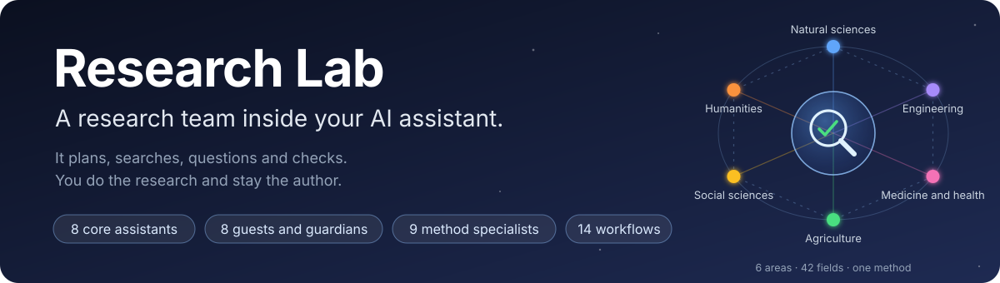
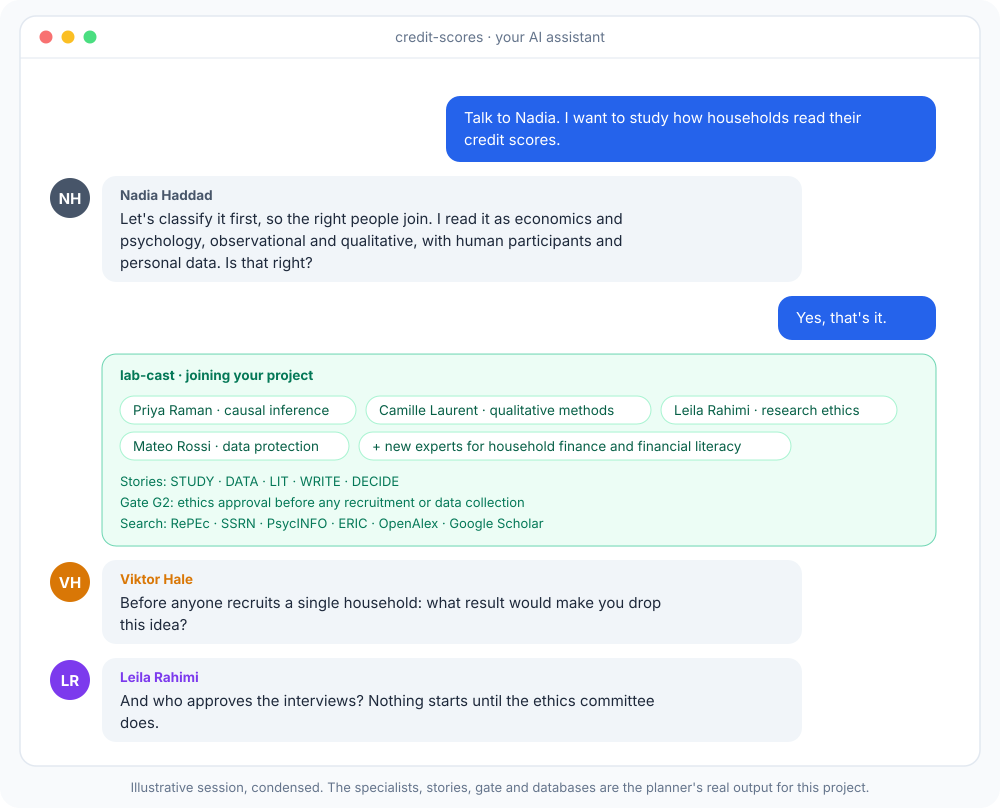
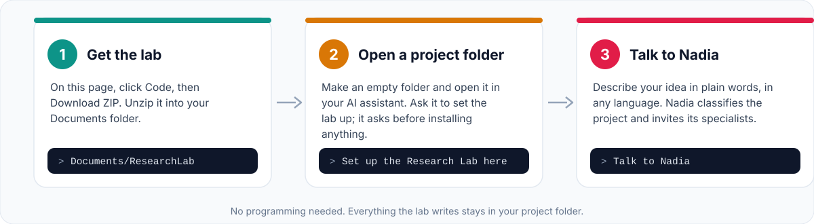
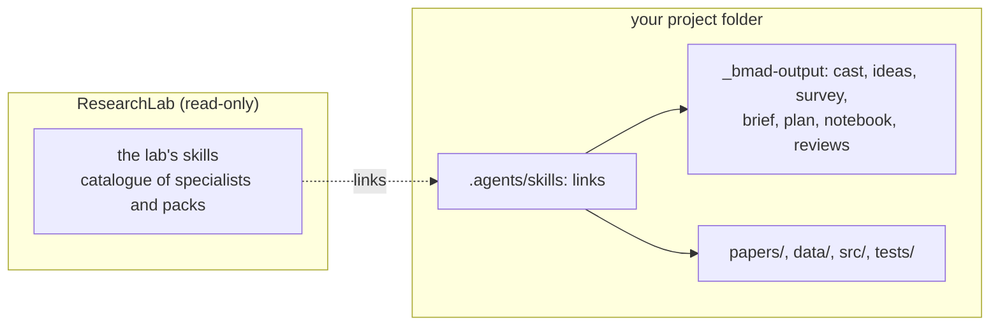
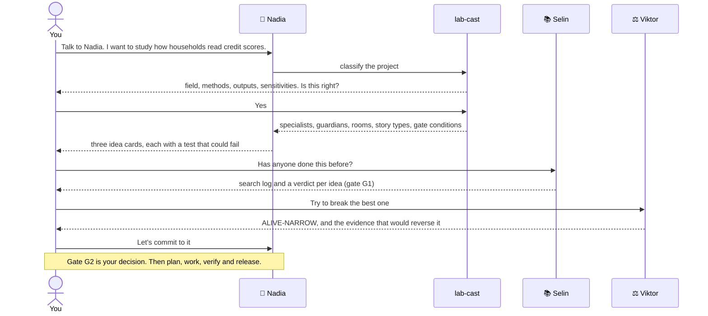
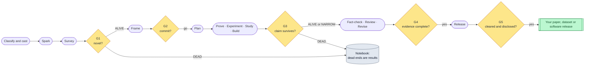
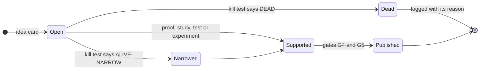
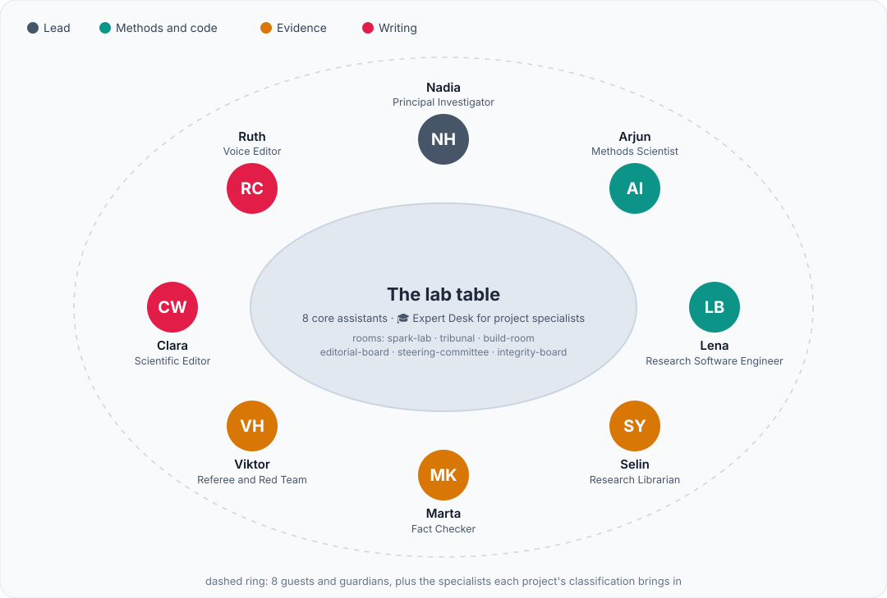
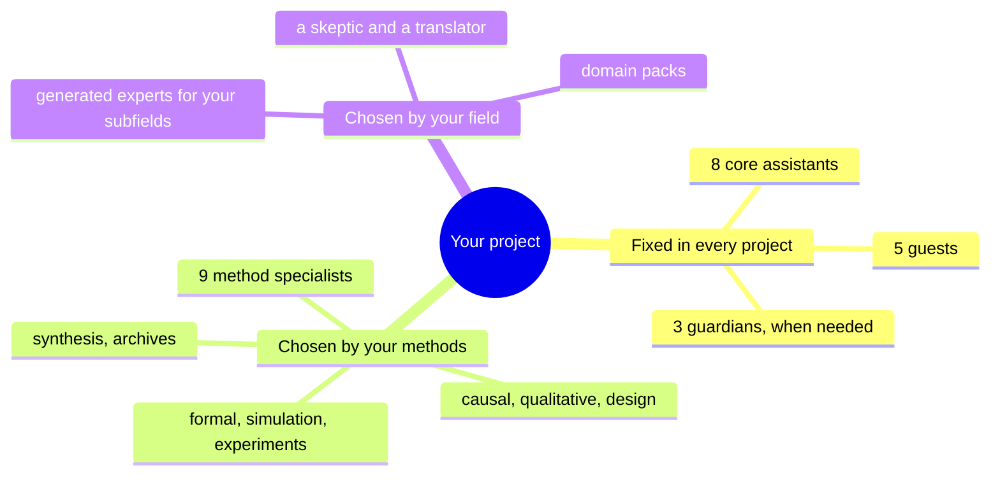
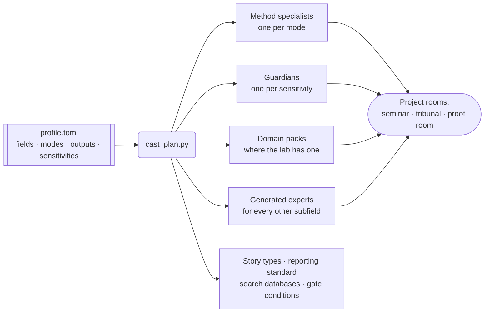

<p align="center">
  
</p>

<h3 align="center">Hear the hard questions before your referees ask them.</h3>

<p align="center">
  Eight AI research assistants, plus the specialists your field calls for, inside the AI assistant you already use.<br>
  They plan, search, question and check. <b>You do the research and stay the author.</b>
</p>

<p align="center">
  
  
  
  
  
  <a href="https://github.com/ozcankasal/ResearchLab/actions/workflows/checks.yml"></a>
  
</p>

<p align="center">
  <a href="#see-it">See it</a> ·
  <a href="#start">Start</a> ·
  <a href="#say">What to say</a> ·
  <a href="#method">How it works</a> ·
  <a href="#team">Team</a> ·
  <a href="#specialists">Specialists</a> ·
  <a href="#responsible">Responsible use</a> ·
  <a href="#faq">FAQ</a> ·
  <a href="#contribute">Contribute</a>
</p>

---

> **Every claim has a kill criterion. Every citation has a page number. Every number has a seed.**

Research Lab is a free, open-source add-on for AI coding assistants that support Agent Skills. It supports researchers in any discipline, from mathematics and physics to medicine, economics and history. It does not write your papers. It helps with the parts of research that are easy to get wrong:

- framing a question so that it can fail;
- finding who already did it, under another name;
- trying to break a claim before you invest in it;
- keeping proofs, data, numbers and citations honest;
- documenting the work so that others can rerun it.

You stay the author and the decision-maker. The lab records where AI helped, so you can disclose it accurately.

<a id="see-it"></a>
## ✨ See it in action

<p align="center">
  
</p>

You describe an idea in plain words. Nadia, the lab's principal investigator, classifies it, and the lab brings in the people that project needs. A survey of households gets an ethics officer, a data protection officer and a qualitative-methods specialist. A proof gets a formal-verification specialist and a proof room. An archive project gets a historian of sources.

<a id="start"></a>
## 🚀 Start your first project

<p align="center">
  
</p>

**No programming needed.** You need an AI coding assistant that supports Agent Skills, the open `SKILL.md` format; it can run in a terminal, a code editor or a desktop app. Then:

1. **Get the lab.** Click **Code → Download ZIP** at the top of this page, and unzip it into your Documents folder as `ResearchLab`.
2. **Open an empty project folder** in your AI assistant, and paste:
   > Set up the Research Lab from `~/Documents/ResearchLab` in this folder. Follow its BOOTSTRAP.md, and explain each step to me in plain words.

   The assistant checks the two free tools the setup needs, and asks before it installs anything. It also asks for your name and affiliation. Setup takes a few minutes.
3. **Start a new session and say "Talk to Nadia"**, followed by your idea, in any language.

📖 The full walkthrough, with examples, file locations and troubleshooting, is in **[Getting started, without programming](docs/getting-started.md)**.

<details>
<summary><b>Comfortable with a terminal? One command.</b></summary>

You need [uv](https://docs.astral.sh/uv/) and Node.js (for `npx`).

```bash
git clone https://github.com/ozcankasal/ResearchLab.git ~/ResearchLab
uv run ~/ResearchLab/tools/install_lab.py ~/my-project --author "Your Name" --affiliation "Your Lab"
```

The installer:

- installs BMad in the project, if it is missing;
- links the lab's skills, or copies them where links aren't allowed;
- registers the module;
- hands the lab's research-software standards to `bmad-build`.

Running it again is safe: it keeps your answers and tidies up skills the lab has retired. Your clone of the lab stays read-only, and everything a project produces lands in the project.



</details>

<a id="say"></a>
## 💬 What you can say

Talk to the lab in plain sentences. Nadia sends each request to the right assistant.

| You say | Who helps | What you get |
|---|---|---|
| "Give me research ideas about …" | the Spark room | idea cards: a claim, its smallest test, and what would kill it |
| "Has anyone done this before?" | 📚 Selin | a search log in your field's databases, and a verdict for each idea |
| "Try to break my idea" | ⚖️ Viktor and your field's skeptics | a kill test: **ALIVE**, **ALIVE-NARROW** or **DEAD**, with reasons |
| "Design the study" | 🧪 Arjun and your method specialists | a protocol written before any data is collected |
| "Check my references and numbers" | 🔎 Marta | every source opened and quoted with a page number; every number traced to its script |
| "Review my draft like a referee" | ⚖️ a panel of independent referees | reports, an editor's decision, and a plan for your revisions |
| "Get my code and data ready to publish" | 🛠️ Lena | a tested release bundle, and an AI-use statement drafted from the notebook |
| "Where were we?" | 🧭 Nadia | the project's state, read from the notebook, and the next step |

A first week might look like this:



<a id="method"></a>
## 🧭 How a project runs

Every project starts by being classified. The classification decides who joins and what the rest of the method expects. Then come nine phases and five gates, with a notebook that is only ever added to. At every gate the lab lays out the evidence, and you make the call.



Every claim lives in a register, with a kill criterion from the day it is written down:



Work is planned as typed stories, each with acceptance criteria someone else can check: `THM` and `LEM` for proofs, `EXP` for experiments, `STUDY` for empirical studies, `DATA` for datasets, `CODE` for software, `LIT` for literature, `FORMAL` for formal verification, `WRITE` for writing and `DECIDE` for decisions. Your project's classification decides which types apply. The full method is in [`lab-method.md`](skills/bmod-lab/help/lab-method.md).

<a id="team"></a>
## 👥 The core team

<p align="center">
  
</p>

Eight assistants with fixed names work on every project, in every field:

| | Assistant | Ask them to |
|---|---|---|
| 🧭 | **Nadia Haddad**, Principal Investigator | classify and plan your project, prepare each gate's decision, suggest the next step |
| 🧪 | **Arjun Iyer**, Methods Scientist | design a study or experiment, size the sample, review the statistics, reproduce a result |
| 🛠️ | **Lena Brandt**, Research Software Engineer | design tests, curate a dataset, set up a reproducible repository, package a release |
| 📚 | **Selin Yalçın**, Research Librarian | find who did it first, under every name it has had |
| 🔎 | **Marta Kowalczyk**, Fact Checker | trace every claim, citation and number to its evidence |
| ⚖️ | **Viktor Hale**, Referee and Red Team | steelman your claim, then find its weakest link |
| ✒️ | **Clara Whitfield**, Scientific Editor | give feedback on your abstract, contributions, structure and referee replies |
| 🪶 | **Ruth Calloway**, Voice Editor | flag generic phrasing and help your writing read clearly in your own voice |
| 🎓 | **Expert Desk** | put you in conversation with any of your project's own specialists |

<details>
<summary><b>Guests and guardians, also fixed and named</b></summary>

Five guests who disagree for a living:

- **Jamie**, a smart outsider: "what does that term mean?"
- **Lucien**, a historian of science and ideas: "who did this before, under which name?"
- **Grace**, a statistician: "how many analyses did you try?"
- **Emre**, a practitioner: "what changes on Monday morning?"
- **Hannah**, an IP and disclosure officer: "can this leave the building yet?"

Three guardians who join when your project needs them:

- **Leila Rahimi** (research ethics) for people, animals or clinical work;
- **Mateo Rossi** (data protection) for personal data;
- **Aiko Mori** (security and dual-use) for results that could be misused.

They meet in six rooms: `spark-lab`, `tribunal`, `build-room`, `editorial-board`, `steering-committee` and `integrity-board`.

</details>

<a id="specialists"></a>
## 🎓 Specialists for your project

The cast has fixed layers and project layers:



When a project starts, `lab-cast` classifies it on four axes, and you confirm the classification:

- **field**, using the 42 OECD Fields of Science and Technology;
- **research mode**: formal, computational, experimental, observational, qualitative, design, synthesis or archival;
- **outputs**: paper, software, dataset, patent or report;
- **sensitivities**, such as human participants, personal data, clinical work or dual-use.

A tested script, `cast_plan.py`, turns the classification into the project's plan:



Here is what the planner produces for four very different projects. This is real output, abridged:

| Project | Method specialists | Domain experts | Guardians | Stories and standard |
|---|---|---|---|---|
| *Model theory of quantum mechanics*<br>1.1 Mathematics, 1.3 Physical sciences · formal | Seo-yeon (formal verification), Pedro (small cases) | the mathematics and physics packs; new experts for model theory and quantum mechanics | none | `THM` `LEM` `FORMAL`, plus a proof room |
| *How households read their credit scores*<br>5.2 Economics, 5.1 Psychology · observational and qualitative | Priya (causal inference), Camille (qualitative methods) | new experts for household finance and financial literacy | ethics, data protection | `STUDY` `DATA`; ethics approval before recruitment |
| *Merchant networks in the Levant trade*<br>6.1 History, 5.2 Economics · archival and computational | Yusuf (archives), Sana (simulation and ML) | a new expert for Ottoman economic history | none | `DATA` `CODE` `EXP`; search in JSTOR and archive catalogues |
| *Early warning model for sepsis*<br>3.2 Clinical medicine, 1.2 Computer science · computational and observational | Sana (simulation and ML), Priya (causal inference) | new experts for critical care and clinical prediction, and a clinician user | ethics, data protection, IP | `STUDY` `DATA` `CODE`; trial and ethics conditions at gate G2, no personal data in any deposit |

The method specialists, guardians and domain packs are named and fixed. Today's packs cover mathematics, physics, and quantum information and computing; a new pack is one TOML file. Generated experts are designed for your subfields and grounded in real works that have been opened and checked. All personas are fictional: real researchers are cited, never voiced.

Here is a scene from the kill test of the first project that went through the lab. It is condensed and dramatized, but the verdict and the sources are the real ones:

> 🧭 **Nadia:** Before you spend a week on it: what would kill the cross-pair rule?<br>
> ⚖️ **Viktor:** Nuclear physicists counting the same zeros. Selin?<br>
> 📚 **Selin:** Searched "pole problem", "norm overlap kernel" and "number projection". The self-pair rule is known (Dobaczewski et al., 2007). Nobody counts the cross-pair zeros. ALIVE-NARROW.<br>
> 🔎 **Marta:** Dobaczewski is VERIFIED, page 6. It says *poles*, not zeros. The wording needs fixing.<br>
> 🪶 **Ruth:** And "pivotal" says nothing. What changes?

## 🔍 Why it exists

Research fails in predictable ways. The lab puts a person, a gate or a script against each one.

| What goes wrong | How the lab helps |
|---|---|
| Only about 1 in 5 citers have read the paper they cite ([Simkin and Roychowdhury](https://arxiv.org/abs/cond-mat/0212043)). | 🔎 **Marta** opens every source. A citation counts as VERIFIED only with a verbatim quote and a page number. |
| Chatbots invent references: 18% to 55% of them, in [one study](https://pmc.ncbi.nlm.nih.gov/articles/PMC10484980/). | `refcheck.py` checks every `.bib` entry against Crossref, DataCite and arXiv. A suggested reference stays UNVERIFIED until someone opens it. |
| The paper that scoops you sits in the next field, under another name. | 📚 **Selin** searches by the object, not the word, in the databases your field actually uses. |
| Every field kills claims its own way: confounding, missing controls, dequantization, anachronism. | `lab-cast` brings in the specialists who know how claims die in your field and method. |
| Studies with people or personal data start before anyone asks for approval. | Guardians join automatically when your project involves people, personal data, animals, clinical work or dual-use risk, and their conditions become gate checks. |
| Debugging stops as soon as the numbers look right. | 🧪 **Arjun** helps you freeze the analysis plan before the run, and report every analysis you tried. |
| Generic, inflated phrasing creeps into drafts. | 🪶 **Ruth** flags it in any language and suggests plainer wording in your own voice. |

## 🔧 Checks you can rerun

Six small scripts do the mechanical checking. They use the Python standard library only, and each one has tests.

| Script | What it does |
|---|---|
| [`cast_plan.py`](skills/lab-cast/scripts/cast_plan.py) | turns a project's classification into its specialists, guardians, rooms, story types, reporting standard, search databases and gate conditions |
| [`storyboard.py`](skills/lab-plan/scripts/storyboard.py) | checks the story files (dependencies, cycles, claim IDs, acceptance criteria) and prints the board, the ready list and a Mermaid graph |
| [`refcheck.py`](skills/lab-factcheck/scripts/refcheck.py) | checks every `.bib` entry against Crossref, DataCite and arXiv, with no personal data in any request |
| [`ledger.py`](skills/lab-factcheck/scripts/ledger.py) | maps every theorem, proposition and citation in a LaTeX paper to its evidence, and flags overclaiming words |
| [`tells.py`](skills/lab-voice/scripts/tells.py) | flags generic and inflated phrasing in any language, using language packs written for your project the first time it meets that language |
| [`bundle.py`](skills/lab-release/scripts/bundle.py) | assembles a Zenodo or arXiv deposit, refuses private files and secrets, warns about public LaTeX comments, and test-runs the code from a clean copy |

<a id="responsible"></a>
## 🔒 Responsible use

The lab is built to make research more careful, not to produce it on your behalf. These commitments are part of every assistant and workflow:

| Commitment | In practice |
|---|---|
| **You are the author** | AI tools cannot be authors. The assistants propose, question and check; you decide, write and sign. Text drafted on request is marked as a draft for you to rewrite. |
| **AI help is recorded** | AI assistance that reaches anything leaving the project goes into the notebook as an AI-USE entry. At release, the lab drafts your disclosure statement from those entries. |
| **Nothing is fabricated** | Every citation is opened before it counts, every number regenerates from a script or raw data, and every claim carries its evidence level. |
| **Approvals come first** | When people, personal data, animals or clinical work are involved, the guardians' conditions (approvals, consent, lawful basis) are gate checks, not afterthoughts. |
| **Editing, not disguise** | The voice editor improves clarity. It is not a tool for passing AI-generated text off as your own, or for getting around a venue's policy. |
| **Review stays confidential** | The simulated referees review your own drafts. Manuscripts you referee for others stay out of AI tools unless the venue allows it. |
| **Privacy by default** | No personal data goes in the lab's own requests to bibliographic services. Nothing is uploaded or submitted for you. |

The details, with the ICMJE and arXiv policies they follow, are in [`ETHICS.md`](ETHICS.md).

<a id="faq"></a>
## ❓ FAQ

<details>
<summary><b>Do I need to know how to program?</b></summary>

No. You talk to the lab in plain language, and your AI assistant runs every command after asking you. The [getting-started guide](docs/getting-started.md) is written for researchers who have never used a terminal.

</details>

<details>
<summary><b>Does it write my paper?</b></summary>

No. It helps you plan, search, check and revise, and it gives feedback on your drafts. It drafts text only when you ask, marks that text as a draft for you to rewrite, and records it in the notebook so you can disclose it.

</details>

<details>
<summary><b>Will it hide that I used AI?</b></summary>

No, it does the opposite. The lab records AI help as it happens, and at release it drafts the disclosure statement your venue asks for. The voice editor improves clarity; it is not a way around AI policies.

</details>

<details>
<summary><b>Which AI assistant do I need, and what does it cost?</b></summary>

Any AI coding assistant that supports Agent Skills, the open `SKILL.md` format. Check your assistant's documentation for "skills". The lab is free and MIT-licensed, but most AI assistants need a paid plan.

</details>

<details>
<summary><b>Does my data leave my computer?</b></summary>

Your conversation goes to your AI assistant's provider, as with any AI tool. The lab's own scripts send only bibliographic queries, such as titles and DOIs, to Crossref, DataCite and arXiv, with no personal data. Nothing is uploaded or submitted for you. Before using any AI assistant with confidential or personal data, check your institution's rules; the data protection guardian will ask about them too.

</details>

<details>
<summary><b>Can I use it in my own language?</b></summary>

Yes. Talk to the lab in any language. The voice check builds a language pack the first time it meets a new language, and asks a fluent reader to review it.

</details>

<details>
<summary><b>My field has no domain pack. Does the lab still work?</b></summary>

Yes. For any subfield without a pack, `lab-cast` designs experts for your project: one from each of two rival schools, a skeptic, and a translator from a neighbouring field. Each is grounded in works that have been opened and checked. A pack only makes the experts ready-made. You can [contribute one](CONTRIBUTING.md).

</details>

<details>
<summary><b>Is it allowed by journals and universities?</b></summary>

Most journals and preprint servers allow AI assistance and forbid AI authorship. They require you to take responsibility for the content and to disclose how AI was used. The lab is built around exactly those rules. Policies differ, so check your venue's and institution's policies; the release gate asks you to.

</details>

<details>
<summary><b>Can my co-authors use it too?</b></summary>

Yes. Everything the lab writes is plain text (Markdown and TOML) in your project folder. Share the folder the way you share code or data, for example with git, and each co-author sets up the lab on their own machine.

</details>

<a id="contribute"></a>
## 🤝 Add your field

The lab knows mathematics, physics and quantum computing best today. **Your field could be next.** A domain pack is one TOML file: the fields and keywords that select it, and two or more named, fictional experts, including at least one skeptic who knows how claims die in your field. A test checks every pack, so you'll know when yours is ready.

Wanted:

- domain packs for clinical medicine, economics, history, linguistics, ecology, materials science, law and more;
- method playbooks;
- reviewed language packs for the voice check;
- translations of the getting-started guide.

See [`CONTRIBUTING.md`](CONTRIBUTING.md). Every contribution follows the [code of conduct](CODE_OF_CONDUCT.md) and the lab's [ethics](ETHICS.md).

<details>
<summary><b>What's inside the repository</b></summary>

| Workflow | What it helps with |
|---|---|
| `lab-cast` | classifying the project and bringing in its specialists, guardians, rooms, story types and standards |
| `lab-spark` | turning a hunch into testable idea cards: a claim, its smallest test, its kill criterion |
| `lab-survey` | prior-art search in your field's databases, with a log anyone can rerun, and a verdict per idea (G1) |
| `lab-frame` | the research brief: Heilmeier questions, claim register, non-claims (G2) |
| `lab-plan` | epics and typed stories, riskiest first |
| `lab-prove` | checking a proof: small cases, gap hunt, an adversarial reading |
| `lab-experiment` | a protocol written before the run or the data collection, and results with uncertainties |
| `lab-killtest` | a steelman, independent attacks from your field and methods, and a verdict (G1, G3) |
| `lab-factcheck` | the claim ledger, reference checks, verbatim quotes, number provenance (G4) |
| `lab-referee` | independent simulated referees for your own draft, an editor's decision, a response plan |
| `lab-write` | support for your own paper: setup, outline, consistency checks and feedback; drafts only on request, marked for you to rewrite |
| `lab-voice` | editing for clarity in your own voice, in any language, and your personal style sheet |
| `lab-release` | the disclosure, approvals and AI-use gate (G5), a verified deposit bundle, Zenodo, arXiv and code records |
| `lab-notebook` | decisions, results, dead ends, AI-USE entries, status and weekly digests |

```
skills/                      the module: bmod-lab (record, roster, help) and every lab-* skill
skills/lab-cast/catalogue/   classification rules, method specialists, domain packs
skills/lab-cast/playbooks/   specialists' playbooks (formalization, physical models, advantage audits, …)
tools/cast.py                the core team, guests, guardians and rooms; tools/build_cast.py renders them
tools/install_lab.py         sets the lab up in a project
tools/check.sh               rebuilds, then runs every structural check and test
tools/readme_figures.py      draws the figures in this README from the cast data
docs/getting-started.md      the setup guide for researchers who don't program
docs/best-practices/         the research behind the method, with every source
ETHICS.md                    responsible use: authorship, disclosure, integrity, privacy
BOOTSTRAP.md                 what an AI assistant does when you ask it to set the lab up
```

</details>

## 📚 Built on evidence

The method comes from two research digests in [`docs/best-practices/`](docs/best-practices/), built from 188 sources that were opened and read, not remembered:

- **Research practice:** the Heilmeier catechism, Hamming, Pólya and Lakatos, Tao's advice on proofs and formalization, PRISMA-S search logs, preregistration and blind analysis, Smith on refereeing, Knuth and Halmos on mathematical writing.
- **Software practice:** Wilson et al.'s best practices for scientific computing, statistical tests for quantum programs, mirror circuits, fair benchmarking, Lean blueprints, Zenodo and arXiv packaging, and what goes wrong when AI writes the tests.

Several other sources shape specific parts:

- **Classification:** the OECD Fields of Science and Technology.
- **Reporting standards:** the EQUATOR Network's guidelines for health research, PRISMA 2020 for reviews, and the NeurIPS checklist for machine learning.
- **Responsible use:** the ICMJE recommendations and arXiv's policy on generative AI tools.
- **Voice checks:** Wikipedia's [Signs of AI writing](https://en.wikipedia.org/wiki/Wikipedia:Signs_of_AI_writing).

## Cite and license

If the lab supports your work, you can cite it with the "Cite this repository" button, which reads [`CITATION.cff`](CITATION.cff). The lab is MIT-licensed; see [`LICENSE`](LICENSE). It is built on [BMad](https://github.com/bmad-code-org/BMAD-METHOD).

<p align="center"><b>If the lab catches one bad citation for you, a ⭐ helps the next researcher find it.</b></p>
